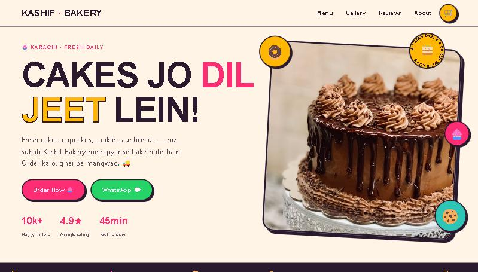
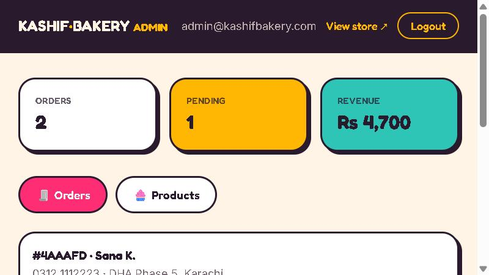

# 🧁 Kashif Bakery — MERN E-commerce


A full-stack online bakery for a Karachi shop: customers browse the menu, build a cart, and
place real orders; the owner manages products and tracks orders from an admin dashboard.
Built as a **production-shaped MERN app** — not a static page. Security-hardened
(see [SECURITY.md](SECURITY.md)).

> **Live demo:** [kashif-bakery.vercel.app](https://kashif-bakery.vercel.app) · _API:_ [kashif-bakery-api.vercel.app/api/health](https://kashif-bakery-api.vercel.app/api/health)
> **Admin:** [/admin](https://kashif-bakery.vercel.app/admin) · `admin@kashifbakery.com` _(password kept private so the public demo data stays intact — available on request)_





---

## ✨ Features

**Storefront**
- Menu loaded from the database, filterable by category (cakes / cupcakes / cookies / breads)
- Cart with quantity controls, persisted to `localStorage`, confetti micro-interactions
- Checkout that **saves the order to MongoDB**, plus an optional WhatsApp confirmation
- Order-success page with a real order number
- Bold, animated, mobile-first UI (scroll reveals, marquee, spinning badge, neo-brutalist styling)

**Admin dashboard** (`/admin`, JWT-protected)
- Live stats: total orders, pending, revenue
- Order management with a kitchen pipeline: `pending → baking → out-for-delivery → delivered`
- Full product CRUD (add / edit / delete, stock toggle)

**Backend**
- REST API with validation, centralised error handling, and server-side price recomputation
  (the client can’t tamper with prices or totals)
- Security: `bcrypt` password hashing, JWT auth, `helmet`, locked CORS, login rate-limiting

---

## 🧱 Tech stack

| Layer | Tech |
|-------|------|
| Frontend | React 18, Vite, Tailwind CSS, React Router, Axios, GSAP |
| Backend | Node, Express, Mongoose |
| Database | MongoDB (Atlas free tier) |
| Auth | JWT + bcrypt |
| Validation | Zod |
| Deploy | Vercel (client + serverless API) · Atlas (DB) — 100% free, no card |

---

## 📁 Structure

```
kashif-bakery/
├── client/                 # React + Vite + Tailwind
│   └── src/
│       ├── components/      # Nav, Hero, MenuGrid, ProductCard, CartDrawer, …
│       ├── pages/           # Home, Checkout, OrderSuccess, AdminLogin, AdminDashboard
│       ├── context/         # CartContext, AuthContext
│       ├── api/client.js    # axios instance (+ JWT interceptor)
│       └── lib/             # confetti, reveal, formatting
└── server/                 # Express REST API
    ├── models/             # User, Product, Order (Mongoose)
    ├── routes/             # auth, products, orders
    ├── middleware/         # auth (JWT), validate (zod), error handling
    ├── utils/schemas.js    # zod request schemas
    ├── seed.js             # seed products + admin
    └── server.js
```

---

## 🚀 Run locally

**Prerequisites:** Node 18+, and a MongoDB connection string (free [Atlas](https://www.mongodb.com/atlas) cluster, or a local `mongod`).

### Quick start (one command)

```bash
npm run install:all                 # install client + server
# create server/.env from server/.env.example (MONGO_URI + JWT_SECRET)
npm run seed                        # load menu + admin
npm run dev                         # runs API + client together
```

<details><summary>Or run each app separately</summary>

### 1. API

```bash
cd server
npm install
cp .env.example .env         # then fill MONGO_URI + JWT_SECRET
npm run seed                 # loads the menu + creates the admin
npm run dev                  # http://localhost:5000
```

### 2. Client

```bash
cd client
npm install
npm run dev                  # http://localhost:5173
```

The Vite dev server proxies `/api` to `http://localhost:5000`, so no CORS setup is needed locally.

</details>

---

## 🔌 API reference

| Method | Route | Access | Purpose |
|--------|-------|--------|---------|
| `GET`  | `/api/products` | public | List menu (`?category=` filter) |
| `GET`  | `/api/products/:id` | public | One product |
| `POST` | `/api/products` | admin | Create |
| `PUT`  | `/api/products/:id` | admin | Update |
| `DELETE` | `/api/products/:id` | admin | Delete |
| `POST` | `/api/orders` | public | Place an order (total recomputed server-side) |
| `GET`  | `/api/orders` | admin | List orders (`?status=` filter) |
| `PATCH`| `/api/orders/:id/status` | admin | Advance order status |
| `POST` | `/api/auth/login` | public | Admin login → JWT (rate-limited) |
| `GET`  | `/api/auth/me` | admin | Current admin |

---

## ☁️ Deploy

Full step-by-step guide: **[docs/DEPLOY.md](docs/DEPLOY.md)**. Everything runs on free tiers with
**no credit card** (Vercel Hobby + Atlas M0). In short:

1. **MongoDB Atlas** — create a free M0 cluster, copy the `MONGO_URI`.
2. **API → Vercel** — import the repo as a project with **Root Directory** `server/` (a `vercel.json`
   runs the Express app as a serverless function). Set `MONGO_URI`, `JWT_SECRET`, `CLIENT_URL`.
   The DB auto-seeds on first request.
3. **Client → Vercel** — import the repo again with **Root Directory** `client/`,
   add `VITE_API_URL=https://<your-api-url>/api`. Deploy.

---

## 🔐 Security notes

Passwords are hashed with bcrypt (cost 12) and never returned. Admin routes require a valid
JWT. Order prices and totals are recomputed from the database on the server. CORS is restricted
to the configured client origin, security headers are set via helmet, and the login route is
rate-limited. Secrets live only in `.env` (gitignored).

---

Built by **[Axiom Web Builder](https://axiomwebbuilder.com)** · Karachi 💜
